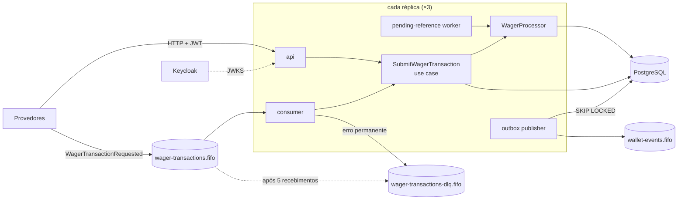
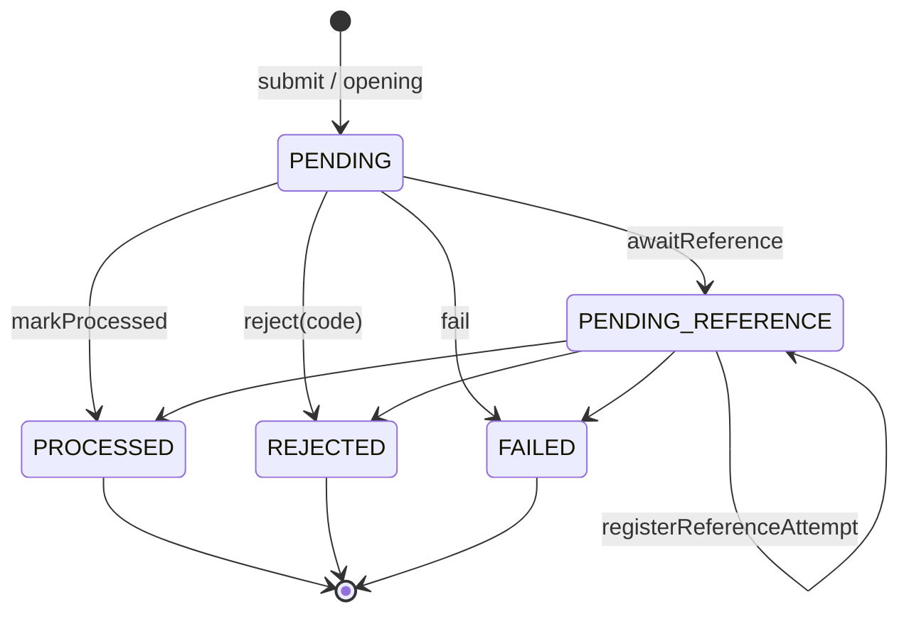
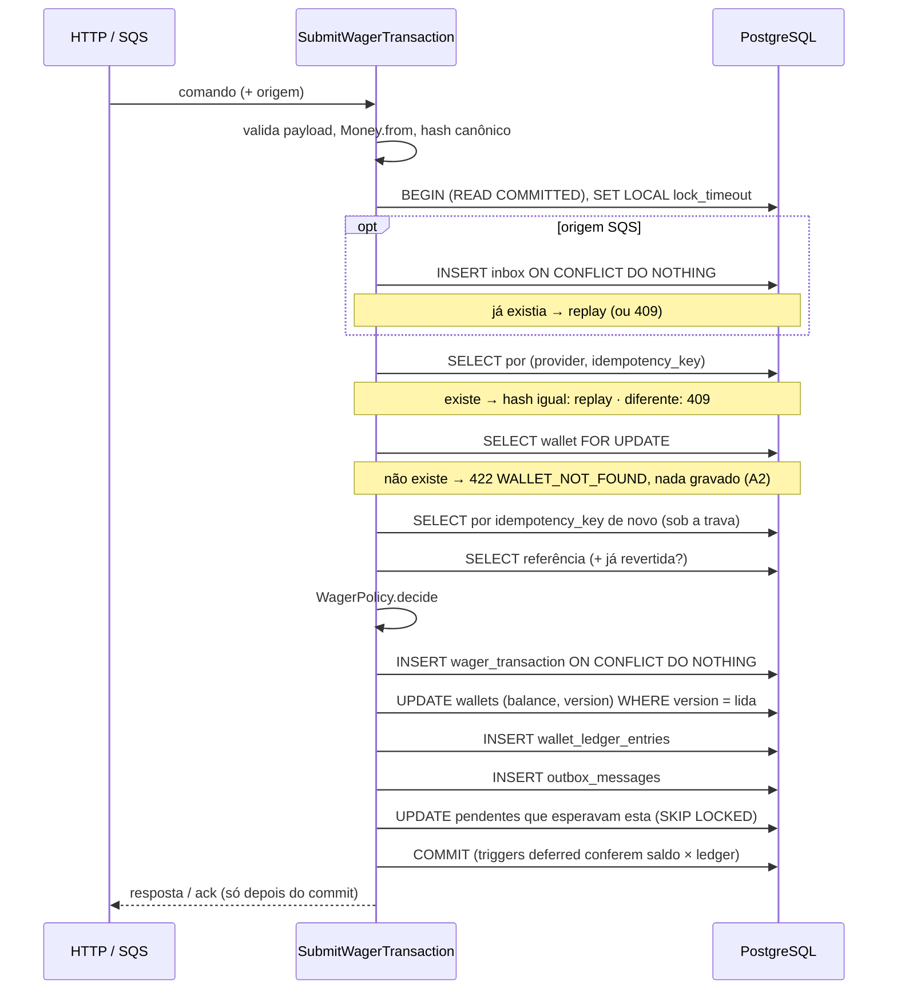

# Arquitetura do Canopy

Este documento explica **como** o Canopy garante correção financeira com várias instâncias, mensagens duplicadas e fora de ordem, e **por que** cada decisão foi tomada. Para subir e testar, veja o [README](README.md).

Sumário: [Visão geral](#visão-geral) · [Camadas](#camadas-e-módulos) · [Domínio](#domínio) · [Persistência e ORM](#persistência-e-orm) · [Garantias no schema](#garantias-no-schema) · [Transações e concorrência](#transações-e-concorrência) · [Fluxo do submit](#fluxo-do-submit) · [Idempotência](#idempotência) · [Regras e interpretações](#regras-de-negócio-e-interpretações) · [Referências pendentes](#referências-pendentes) · [Mensageria](#mensageria) · [Erros e status HTTP](#erros-e-status-http) · [Autenticação](#autenticação) · [Observabilidade](#observabilidade) · [Testes](#testes) · [Escolhas de ferramenta](#escolhas-de-ferramenta) · [Trade-offs e limitações](#trade-offs-e-limitações)

---

## Visão geral

Um único binário roda em vários papéis (`APP_ROLES`): **api** (HTTP), **consumer** (fila de entrada) e **workers** (publisher da outbox e worker de referências pendentes). No Compose, cada réplica roda os três, e o sistema é testado com três réplicas.



A **fonte da verdade é o PostgreSQL**. Ordenação e deduplicação do SQS são otimizações, nunca a garantia (README 8). Toda invariante que importa é aplicada por constraint, trigger ou trava no banco.

## Camadas e módulos

Cada módulo (`wallet`, `wagering`, `messaging`, `reconciliation`, `auth`, `health`, `observability`) segue o mesmo corte hexagonal:

| Camada | Contém | Pode depender de |
|---|---|---|
| `domain/` | entidades, value objects, eventos, erros. Sem NestJS, sem MikroORM | só `domain` |
| `application/` | use cases e **portas** (`abstract class`) | `domain` |
| `infrastructure/` | entidades de persistência, mappers, repositórios, adaptadores SQS e OIDC | `application`, `domain` |
| `presentation/` | controllers, consumer SQS, workers, decorators | `application`, `domain` |

Portas são `abstract class` porque funcionam como token de injeção do Nest sem `@Inject(SYMBOL)`: `{ provide: WalletRepository, useClass: MikroOrmWalletRepository }`.

Duas regras que o linter não expressa são checadas por [`scripts/check-architecture.ts`](scripts/check-architecture.ts), que roda dentro de `bun run lint`:

1. `domain/` não importa `@nestjs`, `@mikro-orm`, `@aws-sdk`, `node:crypto` nem camadas externas;
2. nenhum `Number(`, `parseFloat(`, `parseInt(` ou `.toNumber()` em `domain/` e `infrastructure/`, ou seja, dinheiro nunca vira `number`.

## Domínio

### Money

[`src/shared/domain/money.ts`](src/shared/domain/money.ts). É imutável, com construtor privado e factories `from` e `zero`.

- **Representação:** `decimal.js` numa instância isolada (`Decimal.clone`), com precisão 40 e arredondamento **HALF_EVEN** (arredondamento do banqueiro, que não enviesa somas para cima). Sempre escala 2 na saída (`"10"` → `"10.00"`).
- **Entrada:** o único caminho é `Money.from`, que aceita só `^(0|[1-9]\d*)(\.\d{1,2})?$` com no máximo 18 dígitos inteiros (o limite de `numeric(20,2)`). Isso rejeita `NaN`, `Infinity`, notação científica, sinal, string vazia, zeros à esquerda, mais de 2 casas e qualquer `number` que chegue em tempo de execução. Aceitar de 0 a 2 casas (`"10"`, `"10.5"`) foi a decisão **A6**.
- **Aritmética:** `add`, `subtract` e `negate` são exatos. A única operação que arredonda é `multiply(fator)`, com HALF_EVEN. `subtract` pode dar negativo (a diferença da reconciliação é um exemplo): quem proíbe saldo negativo é a `Wallet`, não o `Money`.
- **Moeda:** operar moedas diferentes lança `CurrencyMismatchError`. O modelo é multi-moeda, sem conversão.
- **Serialização:** `toProps()`/`toJSON()` devolvem `{ amount: string, currency: string }`. Nenhum contrato, evento ou snapshot carrega `number`.

### Wallet e WalletLedgerEntry

[`wallet.ts`](src/modules/wallet/domain/wallet.ts), [`wallet-ledger-entry.ts`](src/modules/wallet/domain/wallet-ledger-entry.ts)

- `Wallet.open` cria a wallet com **`version = 1`** (README 6.2). Saldo inicial positivo vira o lançamento **#1** (`CREDIT` da transação interna `OPENING`). Com saldo inicial zero, não há lançamento.
- Toda mudança de saldo passa por `debit`, `credit` ou `reverseCredit` e devolve o `WalletLedgerEntry` que a explica, com **`sequence` = `version` depois da mudança**. A `version` cresce exatamente 1 quando o saldo muda, e nunca em outro caso. O mesmo contador ordena o ledger (**A4**), o que dá uma sequência monotônica, sem buracos e independente de relógio.
- `debit` sem saldo lança `InsufficientFundsError`. `reverseCredit` (ROLLBACK de WIN ou REFUND) sem saldo lança `ReversalWouldOverdrawError`, um erro **distinto** (README 7.9).
- `WalletLedgerEntry.create` valida `balanceAfter = balanceBefore ± amount`, `amount > 0` e saldos não negativos. Já o `rehydrate` reconstrói o estado persistido **sem** revalidar (README 6.0). O método `isBalanced()` permite checar a aritmética sem lançar erro.

### WagerTransaction: máquina de estados

[`wager-transaction.ts`](src/modules/wagering/domain/wager-transaction.ts)



`PROCESSED`, `REJECTED` e `FAILED` são terminais. Qualquer transição a partir deles lança `InvariantViolationError`, porque isso é erro de programação e não caminho de negócio. `PENDING` só existe dentro da transação SQL que cria a linha e nunca chega a ser commitado.

A transação guarda o **outcome** (`status`, `failureCode`, saldo, `walletVersion` e o momento da decisão) da **primeira** resposta dada. O `recordOutcome` só grava uma vez, e é isso que o replay devolve (README 7.7, **A5**).

### WagerPolicy

[`wager-policy.ts`](src/modules/wagering/domain/wager-policy.ts) é uma função pura. Recebe a transação, a wallet travada, a referência (se houver) e se ela já foi revertida, e decide uma de quatro coisas: `apply(debit | credit | reverseCredit)`, `noop`, `reject(code)` ou `awaitReference`. Concentra todas as regras de RF02 a RF09 numa ordem fixa, então as mesmas entradas sempre geram o mesmo código:

1. a wallet é do `playerId` informado? A moeda é a da wallet?
2. referência ausente ou ela mesma pendente → `awaitReference`;
3. a referência é do mesmo provider, player, wallet, moeda e rodada? → senão `REFERENCE_MISMATCH`;
4. o kind da referência é permitido? (`WIN→BET`, `REFUND→BET`, `ROLLBACK→BET|WIN|REFUND`) → senão `INVALID_REFERENCE_KIND`;
5. a referência está `PROCESSED`? → senão `REFERENCE_NOT_PROCESSED`;
6. reversões: mesmo valor (`AMOUNT_MISMATCH`), uma vez só (`ALREADY_REVERSED`);
7. efeito: `BET` debita (`INSUFFICIENT_FUNDS`); `WIN` e `REFUND` creditam; `LOSS` não move nada; `ROLLBACK` de BET credita e de WIN/REFUND faz `reverseCredit` (`REVERSAL_WOULD_OVERDRAW`). Valor zero vira `noop`.

### Eventos de integração

`IntegrationEvent<T>` é abstrata, com uma subclasse por evento e `eventType`/`version` como tipos literais. O envelope traz `eventId`, `aggregateId`, `correlationId`, `causationId`, `occurredAt` (ISO), `version` e `data`. O `data` usa só `MoneyProps`.

| Evento | Quando |
|---|---|
| `WagerTransactionProcessed` | toda transação aplicada, `LOSS` e `OPENING` inclusive |
| `WagerTransactionRejected` | rejeição por regra de negócio, inclusive `REFERENCE_NOT_FOUND` |
| `WalletBalanceChanged` | **só** quando o saldo muda, com `walletVersion` |
| `WagerTransactionPendingReference` | referência ausente na chegada |

## Persistência e ORM

**MikroORM 7** (o preferido do README), com estas escolhas:

- **Entidades de persistência separadas do domínio** (`*.orm-entity.ts`, definidas com `defineEntity`, sem decorators nem reflection). Mappers explícitos (`*.mapper.ts`) convertem registro ↔ domínio, então o domínio não conhece o ORM (RNF08).
- **Money:** colunas `numeric(20,2)` mapeadas com `p.decimal('string')`. O driver entrega `"975.00"` e só o mapper cria o `Money`. Valor e moeda ficam em colunas separadas (`amount`, `currency`).
- **Operações nativas e explícitas** (`em.insert`, `em.nativeUpdate`, `findOne` com `lockMode`, query builder com `onConflict().ignore()`) em vez do flush do Unit of Work. A ordem dos statements importa, porque os triggers do ledger conferem o estado da wallet no momento do insert, e com operações nativas cada statement é visível e revisável. `disableIdentityMap` nas leituras evita estado velho entre retries.
- **Transações** com `em.fork().transactional()` dentro do adaptador `UnitOfWork`. Os repositórios injetam o `EntityManager` raiz, e dentro da transação o MikroORM resolve o fork pelo `TransactionContext` (AsyncLocalStorage). Fora de contexto, `allowGlobalContext: false` faz o ORM lançar erro em vez de usar um EM global por engano.
- **Migrations** escritas à mão em SQL (`up` e `down`), porque triggers, índices parciais e `REVOKE` não saem do schema generator. A lista é explícita em [`src/database/migrations/index.ts`](src/database/migrations/index.ts), sem descoberta por glob, e o CLI próprio fica em [`scripts/migrate.ts`](scripts/migrate.ts). Rodam com o papel `canopy_migrator`.

**Dois papéis no Postgres** ([`infra/postgres/init.sh`](infra/postgres/init.sh)): `canopy_migrator` é dono do schema e roda DDL; `canopy_app` é o papel da aplicação, só com DML, e a migration revoga dele `UPDATE`, `DELETE` e `TRUNCATE` no ledger.

## Garantias no schema

README 5.9: unicidade, imutabilidade e não-negatividade **no banco**. Migration: [`Migration20261111000100_schema.ts`](src/database/migrations/Migration20261111000100_schema.ts). Cada linha abaixo é testada com SQL direto em [`schema-constraints.spec.ts`](test/integration/schema-constraints.spec.ts).

| Garantia | Como |
|---|---|
| Uma wallet por player e moeda | `UNIQUE (player_id, currency)` |
| Saldo nunca negativo | `CHECK (balance >= 0)` em `wallets`; `CHECK` em `amount`, `balance_before` e `balance_after` do ledger |
| Idempotência persistente, por provedor (**A1**) | `UNIQUE (provider_id, idempotency_key)` |
| Uma operação por id do provedor | `UNIQUE (provider_id, external_transaction_id)` |
| No máximo um lançamento por transação por wallet | `UNIQUE (wallet_id, transaction_id)` no ledger |
| Ledger ordenado e sem duplicata de posição | `UNIQUE (wallet_id, sequence)` |
| Cada transação revertida no máximo uma vez (**A3**) | índice único parcial `(reference_transaction_id) WHERE kind IN ('REFUND','ROLLBACK') AND status = 'PROCESSED'` |
| Aritmética do lançamento | `CHECK (balance_after = balance_before ± amount)` |
| Ledger imutável | trigger `BEFORE UPDATE OR DELETE` que lança erro para qualquer papel + `REVOKE` do papel da app |
| Lançamento descreve a wallet | trigger `BEFORE INSERT`: `sequence = wallets.version`, `balance_after = wallets.balance`, mesma moeda |
| Saldo sempre explicado pelo ledger | **constraint trigger `DEFERRABLE INITIALLY DEFERRED`**: no commit, a wallet precisa ter o lançamento `#version` com `balance_after = balance` (ou estar em `version 1` com saldo 0) |
| Saldo e versão andam juntos | trigger `BEFORE UPDATE`: a versão sobe exatamente 1 quando, e só quando, o saldo muda; identidade (`player_id`, `currency`) imutável |
| Estados válidos | `CHECK` de `kind` e `status`; `REJECTED` ⇔ `failure_code`; `PENDING_REFERENCE` tem `next_retry_at`; `REFUND`/`ROLLBACK` têm referência; `OPENING` só interno |
| Inbox | `PRIMARY KEY (consumer_name, message_id)` |

O trigger *deferred* é a defesa mais forte. Mesmo que um bug na aplicação atualizasse o saldo sem gravar o lançamento, o **commit falharia**.

## Transações e concorrência

**Estratégia: `READ COMMITTED` + lock pessimista por wallet** (`SELECT ... FOR UPDATE` na linha da wallet). A unidade de concorrência é a `walletId` (README 8), e não há lock global.

- Toda mudança de saldo de uma wallet passa pela trava da linha dela. Duas apostas que disputam o mesmo saldo são **serializadas**: a segunda espera, relê o saldo já atualizado e é rejeitada se não couber. Wallets diferentes não se bloqueiam.
- O `UPDATE` do saldo ainda filtra pela versão lida sob a trava (`WHERE id = ? AND version = ?`). Se afetar 0 linhas, isso indica bug e lança erro: é uma defesa extra contra lost update.
- `CHECK (balance >= 0)` e os triggers acima seguram o que escapar.
- **Retry limitado:** o `UnitOfWork` reexecuta a unidade inteira até 3 vezes, com jitter, em `40P01` (deadlock) e `40001` (serialization failure). `SET LOCAL lock_timeout = '5s'` evita que uma trava presa segure uma requisição para sempre. Estourar esse timeout vira erro transitório (503 / retry da mensagem).
- **Ordem das travas:** todo caminho trava **a wallet primeiro**, e só depois linhas de `wager_transactions`. O worker de pendências segue a mesma ordem, e o `UPDATE` que adianta pendentes usa `FOR UPDATE SKIP LOCKED`. Por isso submit e worker não entram em deadlock.

**Por que pessimista, e não otimista?** Numa *hot wallet*, o lock otimista faz quase todas as tentativas concorrentes falharem e repetirem, o que desperdiça trabalho e torna a latência imprevisível. O lock por linha é simples de provar correto, espera em vez de falhar e não é global. O custo é que a vazão de uma única wallet fica limitada ao tempo em que a trava é segurada (cerca de 30 transações/s por wallet no teste de carga; ver [REPORT](test/load/REPORT.md)).

**Alternativa considerada:** o update atômico condicionado `UPDATE wallets SET balance = balance - $1, version = version + 1 WHERE id = $2 AND balance >= $1 RETURNING balance, version`. Ele encurta a seção crítica (um statement em vez de ler, decidir e escrever). Não foi o padrão porque as regras de referência (REFUND, ROLLBACK) precisam ler e validar outras linhas sob a mesma visão consistente da wallet, e a trava explícita deixa isso direto. Para wallets muito quentes, ele é a primeira otimização a fazer.

**Corridas de insert:** dois pedidos com a mesma idempotency key para wallets **diferentes** (payload divergente) não se serializam pela trava. O insert usa `ON CONFLICT DO NOTHING`, e quem perde descobre o conflito **na mesma transação** (o `DO NOTHING` não aborta a transação) e responde replay ou 409.

## Fluxo do submit

[`submit-wager-transaction.use-case.ts`](src/modules/wagering/application/submit-wager-transaction.use-case.ts) e [`wager-processor.ts`](src/modules/wagering/application/wager-processor.ts). HTTP e SQS usam **o mesmo use case** (README 10).



A ordem de escrita é a dos triggers: primeiro a transação (por causa da FK do ledger), depois a wallet e por fim o lançamento (o trigger confere o lançamento contra a wallet já atualizada).

## Idempotência

- **Chave:** o header `Idempotency-Key` é obrigatório no HTTP e é a fonte da verdade. No SQS, ela vem em `data.idempotencyKey`. A unicidade vale por **(provedor, chave)** (**A1**): dois provedores podem gerar a mesma chave sem colidir.
- **Hash canônico** ([`canonical-hash.ts`](src/shared/infrastructure/canonical-hash.ts), [`wager-fingerprint.ts`](src/modules/wagering/application/wager-fingerprint.ts)): SHA-256 do JSON com chaves ordenadas recursivamente, sem espaços e sem campos `undefined`, sobre o subconjunto de negócio: `providerId`, `externalTransactionId`, `walletId`, `playerId`, `roundId`, `gameId`, `kind`, `money` (normalizado por `Money`, então `"10"` e `"10.00"` geram o mesmo hash) e `referenceExternalTransactionId` (`null` quando ausente). O header, o `messageId` e outros metadados de transporte ficam de fora. `number` é recusado no hash, para que formatação de float nunca afete a decisão.
- **Replay** (mesma chave e mesmo hash): devolve **a primeira resposta** gravada, com `idempotentReplay: true`, incluindo o saldo e a `walletVersion` daquele momento, e com o mesmo status HTTP (200, 202 ou 422). Uma transação que respondeu 202 e depois foi resolvida pelo worker **continua** respondendo 202 no replay (**A5**). O estado atual vem do `GET /wagering/transactions/:id`.
- **Conflito:** mesma chave com outro hash → **409 `IDEMPOTENCY_CONFLICT`**, nunca replay. O mesmo `externalTransactionId` com outra chave também dá 409.
- **HTTP e SQS compartilham a idempotência:** a mesma operação pelos dois canais debita uma vez só.
- **Inbox** (só SQS): `(consumerName, messageId)` do envelope, gravado **na mesma transação** que o efeito. Se a linha existe, a entrega anterior commitou.

## Regras de negócio e interpretações

O README pede que interpretações adicionais sejam documentadas. Estas são as minhas:

| # | Interpretação | Por quê |
|---|---|---|
| A1 | Idempotência única por `(provider_id, idempotency_key)` | chaves de provedores diferentes não devem colidir |
| A2 | `WALLET_NOT_FOUND` responde **422 sem persistir** a transação | a linha precisaria de uma FK para uma wallet inexistente; a resposta é estável porque um id de wallet não passa a existir depois |
| A3 | Uma transação é revertida **no máximo uma vez, qualquer que seja o tipo** | o README diz "pelo mesmo tipo de operação", mas permitir um REFUND **e** um ROLLBACK da mesma BET devolveria o dinheiro duas vezes. Um ROLLBACK **de um REFUND** continua possível, porque referencia o REFUND, não a BET |
| A4 | Ledger com `sequence` = `wallets.version`, usado como cursor | ordem real de aplicação, sem depender de relógio entre instâncias |
| A5 | Replay devolve sempre a primeira resposta | README 7.7; o estado atual fica no `GET` |
| A6 | Money na entrada aceita 0 a 2 casas; a saída sempre tem 2 | `"10"` é um valor válido; mais de 2 casas é rejeitado |
| — | `WIN` pode ou não referenciar uma `BET`; se referenciar, valem as regras de referência | README 7: "pode referenciar" |
| — | Valor zero é aceito e não move saldo (sem lançamento, sem `WalletBalanceChanged`) | o ledger exige `amount > 0`; uma aposta de 0,00 é registrada como processada |
| — | `OPENING` gera `WagerTransactionProcessed` e `WalletBalanceChanged` | é uma transação aplicada que mudou o saldo |
| — | Rejeições guardam `reference_transaction_id` quando a referência foi encontrada | auditoria: dá para saber qual BET um ROLLBACK recusado tentou reverter |

## Referências pendentes

README 7.1. [`resolve-pending-references.use-case.ts`](src/modules/wagering/application/resolve-pending-references.use-case.ts)

- Uma referência ausente na chegada vira `PENDING_REFERENCE` com `next_retry_at = agora + 1 s`, o evento `WagerTransactionPendingReference` e a resposta **202**.
- O worker (papel `workers`, em toda réplica) busca as pendentes vencidas e processa **uma transação SQL por item**: trava a wallet, depois a linha (`SKIP LOCKED`; se outra instância a segura, pula) e roda **o mesmo `WagerProcessor`** de uma submissão nova.
- **Backoff:** 1 s, 2 s, 4 s… com teto de 5 min. **Limite: 10 tentativas** do worker, cerca de 13 minutos no total, e depois `REJECTED / REFERENCE_NOT_FOUND` com o evento. A justificativa é que rodadas de cassino duram segundos: um provedor que atrasa uma BET por mais de alguns minutos tem um problema operacional, e ficar esperando para sempre deixaria o provedor sem resposta final. Os parâmetros são configuráveis.
- **Adiantamento:** quando qualquer transação chega a um estado final, as pendentes que a esperavam ficam vencidas na hora. Assim o backoff só pesa quando a referência realmente não existe.
- Se a referência chega mas é rejeitada, a pendente termina em `REFERENCE_NOT_PROCESSED`.

## Mensageria

### Consumidor SQS (entrada)

[`wager-transaction-requested.consumer.ts`](src/modules/wagering/presentation/wager-transaction-requested.consumer.ts)

- Long polling (até 10 mensagens), envelope validado com zod. Mensagens do mesmo `MessageGroupId` (a wallet) são processadas **em ordem**, e grupos diferentes em paralelo.
- **Ack (`DeleteMessage`) só depois que o use case retornou**, ou seja, depois do commit.
- **Classificação de falhas** ([`sqs-error-classifier.ts`](src/modules/wagering/presentation/sqs-error-classifier.ts)):

| Tipo | Exemplos | Ação |
|---|---|---|
| sucesso | `PROCESSED`, `REJECTED`, `PENDING_REFERENCE` | ack |
| negócio | `WALLET_NOT_FOUND` | ack (resultado final) |
| permanente | JSON inválido, envelope inválido, `OPENING`, conflito de idempotência | **DLQ na hora** (com `reason` e `detail`) + ack |
| transitório | Postgres fora, conexões esgotadas, `lock_timeout`, erro desconhecido | sem ack; `ChangeMessageVisibility` para 2ⁿ s (teto 5 min); o redrive do broker leva à DLQ após **5** recebimentos |

  Erro desconhecido é tratado como transitório de propósito: o limite de redrive o contém, e classificá-lo como permanente poderia descartar uma operação financeira válida.
- **Redelivery depois do commit** (processo morto entre o commit e o ack): a inbox detecta, e o consumer só dá ack, sem novo débito. Isso é testado com um processo separado que faz `process.exit(137)` exatamente nesse ponto.
- **SIGTERM:** para o long polling (aborta a requisição), espera as mensagens em andamento por até 20 s e devolve visibilidade 0 às que ainda não começaram.
- **Achado:** abortar um long poll no cliente não cancela a requisição no servidor. A próxima mensagem pode ir para esse "receptor fantasma" e ficar invisível até o visibility timeout. Não há perda, só atraso, e a AWS se comporta igual.

### Transactional outbox (saída)

[`publish-outbox.use-case.ts`](src/modules/messaging/application/publish-outbox.use-case.ts)

- Eventos são gravados em `outbox_messages` **na mesma transação** da mudança de estado. **Nada é publicado antes do commit**: o publisher só lê linhas commitadas.
- Cada ciclo é uma transação curta: `SELECT ... FOR UPDATE SKIP LOCKED LIMIT 100` (do mais antigo para o mais novo), `SendMessageBatch` para `wallet-events.fifo` (`MessageGroupId = aggregateId`, `MessageDeduplicationId = eventId`), `published_at` nos enviados e `attempts++` com backoff (1 s … 5 min) nos que falharam.
- O envio acontece **com as linhas travadas**: publishers concorrentes (um por réplica) pulam o lote uns dos outros em vez de reenviá-lo.
- **Entrega at-least-once:** se o processo morre depois de enviar e antes do commit, as travas somem com a conexão e o lote é reenviado. É seguro porque o SQS FIFO descarta o mesmo `MessageDeduplicationId` dentro de 5 min, e consumidores devem deduplicar por `eventId`.
- **Recuperação:** um evento commitado por uma instância que morreu antes de publicar é publicado por qualquer outra (testado).

## Erros e status HTTP

Um único formato de erro em todos os endpoints ([`http-exception.filter.ts`](src/shared/presentation/http-exception.filter.ts)):

```json
{ "error": { "code": "IDEMPOTENCY_CONFLICT", "category": "CONFLICT", "retryable": false, "message": "...", "correlationId": "..." } }
```

Rejeições de negócio de `POST /wagering/transactions` **não** são erros: a transação é persistida e a resposta tem o mesmo formato de sucesso, com `status: "REJECTED"` e `failureCode`.

| Situação | Status | O provedor pode reenviar? |
|---|---|---|
| Processada (nova ou replay) | **200** + `idempotentReplay` | não precisa |
| Wallet criada | **201** | — |
| Aceita, aguardando referência | **202** | sim, mesmo payload (vira replay) |
| Payload inválido, `Idempotency-Key` ausente, cursor inválido | **400** `INVALID_PAYLOAD` | não; corrigir |
| Sem token ou token inválido | **401** `UNAUTHENTICATED` | não; obter token |
| Token de outro provedor / backoffice submetendo | **403** `FORBIDDEN` | não |
| Wallet/transação não encontrada (GET) | **404** | não |
| Mesma key, outro payload; wallet duplicada | **409** | não; nova key |
| Rejeição por regra de negócio | **422** + `failureCode` | não |
| Falha transitória (banco fora, `lock_timeout`, IdP inacessível) | **503** + `Retry-After` | **sim** |
| Erro inesperado | **500** | sim, com cautela |

### Taxonomia de `failureCode`

| Código | Categoria | Quando |
|---|---|---|
| `INVALID_PAYLOAD` | validação | campos ausentes, Money inválido, `OPENING` submetido |
| `IDEMPOTENCY_CONFLICT` | conflito | mesma key (ou mesmo `externalTransactionId`) com outro payload |
| `WALLET_NOT_FOUND` | negócio | wallet inexistente (422, não persistido) |
| `WALLET_PLAYER_MISMATCH` | negócio | a wallet não é do `playerId` informado |
| `CURRENCY_MISMATCH` | negócio | moeda da operação ≠ moeda da wallet |
| `INSUFFICIENT_FUNDS` | negócio | BET maior que o saldo |
| `REVERSAL_WOULD_OVERDRAW` | negócio | ROLLBACK de WIN/REFUND deixaria saldo negativo (distinto do anterior, README 7.9) |
| `REFERENCE_NOT_FOUND` | negócio | limite de tentativas do worker esgotado |
| `REFERENCE_MISMATCH` | negócio | referência de outro provider, player, wallet, moeda ou rodada |
| `INVALID_REFERENCE_KIND` | negócio | REFUND de não-BET, ROLLBACK de LOSS/ROLLBACK, WIN referenciando não-BET |
| `REFERENCE_NOT_PROCESSED` | negócio | a referência terminou `REJECTED` ou `FAILED` |
| `AMOUNT_MISMATCH` | negócio | REFUND/ROLLBACK com valor diferente da referência |
| `ALREADY_REVERSED` | negócio | a referência já tem um REFUND ou ROLLBACK processado (A3) |
| `INFRA_PERMANENT_FAILURE` | infra | status `FAILED`, para auditoria |

## Autenticação

README 2: um IdP externo, sem tabela de usuários. **Keycloak** com o realm `wagering`, e cada provedor é um client OAuth2 (*client credentials*) com o claim `provider_id` fixo e audience `canopy-api`.

- **Ponto de extensão:** [`ProviderIdentityPort`](src/modules/auth/application/provider-identity.port.ts). O guard só conhece essa porta. Trocar para Zitadel, Auth0, Cognito, mTLS ou API keys é escrever outro adaptador.
- **Validação** ([`oidc-provider-identity.ts`](src/modules/auth/infrastructure/oidc-provider-identity.ts), com `jose`): assinatura contra o JWKS do IdP (em cache e rebuscado quando aparece um `kid` novo, ou seja, rotação de chave), **somente algoritmos assimétricos** (bloqueia `alg: none` e o ataque de trocar RS256 por HS256), `iss`, `aud`, `exp` e `nbf`, com 5 s de tolerância de relógio.
- **Guard global** (`APP_GUARD`): toda rota HTTP exige token, exceto as marcadas com `@Public()` (`/health/*`, `/metrics`).
- **Autorização:** um provedor só submete em nome próprio (403 se `body.providerId` ≠ claim). Só lê as próprias transações: pelo id interno, a de outro provedor responde **404**, para não confirmar que o id existe; pela rota `/providers/:providerId/...`, outro provedor recebe **403**. O backoffice (sem `provider_id`) lê e reconcilia, mas não submete.
- **SQS** é canal interno confiável: sem token. A identidade do provedor contida na mensagem passa pelas mesmas regras de domínio.
- Se o JWKS estiver inacessível, a resposta é **503** (o problema é nosso), não 401.

## Observabilidade

- **Logs** JSON com pino. Um `AsyncLocalStorage` próprio leva `correlationId` (header `X-Correlation-Id` ou gerado), `messageId`, `transactionId`, `walletId` e `providerId` para **toda** linha de log, inclusive nos workers e no consumer. `amount`, `balance`, `authorization` e campos afins são trocados por `[REDACTED]`.
- **Métricas** em `GET /metrics`, publicadas pela porta `AppMetrics` (a camada de aplicação não conhece Prometheus):

| Métrica | Tipo | Labels |
|---|---|---|
| `wager_transactions_total` | counter | `status`, `kind`, `source` (`http`, `sqs`, `pending_worker`) |
| `wager_processing_duration_seconds` | histogram | `source`, `kind`, `outcome` |
| `idempotent_duplicates_total` | counter | `source` (`http`, `sqs_inbox`, `sqs_idempotency_key`) |
| `processing_retries_total` | counter | `reason` (`db_deadlock`, `db_serialization`, `sqs_transient`) |
| `lock_conflicts_total` | counter | `type` (`deadlock`, `serialization`, `lock_timeout`, `insert_race`) |
| `dlq_messages_total` | counter | `reason` |
| `outbox_lag_seconds` | gauge | idade do evento pendente mais antigo, lida do banco a cada scrape |
| `outbox_published_total`, `outbox_publish_failures_total` | counter | — |
| `reconciliations_total`, `reconciliation_mismatches_total` | counter | `consistent` |
| `pending_reference_resolutions_total` | counter | `result` |
| métricas padrão de processo | | |

  Os contadores são **por processo**: o Prometheus soma as réplicas na consulta.
- **Health:** `/health/live` (não toca dependências) e `/health/ready` (`SELECT 1` com timeout + `GetQueueAttributes`).
- **Reconciliação** (`POST /wallets/:id/reconciliation`): reconstrói o saldo com soma exata no Postgres sob `FOR SHARE` (nenhuma mudança de saldo commita durante a checagem), confere também o último lançamento contra saldo e versão, e **nunca corrige**. Uma divergência é logada, contada em métrica e devolvida com `consistent: false`, `difference` e `findings`.

## Testes

Nenhum teste substitui Postgres ou SQS por mocks. Os únicos "fakes" são o relógio e os parâmetros de backoff (configurados curtos em `.env.test`).

| Suíte | O que prova |
|---|---|
| **Unidade** (`src/**/*.spec.ts`) | Money (escala, HALF_EVEN, entradas inválidas, moedas), invariantes da Wallet e do ledger, máquina de estados, todas as regras da `WagerPolicy`, hash canônico e payload divergente, classificação de erros SQS, verificação de JWT (expirado, issuer/audience errados, chave estranha, `alg: none`, HS256), cursor do ledger, worker com SIGTERM |
| **Integração** (`test/integration`) | migrations up/down; cada constraint e trigger em SQL direto; atomicidade wallet/ledger/inbox/outbox; regras de cada kind via HTTP; idempotência; inbox e redelivery; DLQ e redrive; **queda real do banco** (`ALTER ROLE ... CONNECTION LIMIT 0`) com retry; processo morto entre commit e ack; dois publishers sobre a mesma outbox; referências fora de ordem; consultas; reconciliação com divergência induzida; métricas; auth com Keycloak real |
| **Concorrência** (`test/concurrency`) | paralelismo real num processo e em **3 processos** separados: a mesma aposta 50× → 1 débito; 100,00 com 2×80,00 → uma aceita, uma rejeitada, saldo 20,00, um débito; hot wallet; muitas wallets; a mesma mensagem para 3 consumers; reversão antes da referência; **SIGKILL das 3 instâncias no meio do tráfego**, reinício e reenvio pelos provedores, com totais exatos |
| **Carga** (`bun run test:load`) | vazão, p50/p95/p99, erros, contadores e outbox lag com 3 réplicas; reconciliação de todas as wallets ao final; ver [REPORT](test/load/REPORT.md) |

**Invariante final** em todo teste de integração e concorrência (`afterEach`): para todas as wallets, `balance = Σ créditos − Σ débitos do ledger`, e o ledger não tem buracos e termina em `sequence = version`.

A suíte de concorrência rodou **10 vezes seguidas** sem falha antes do merge. O CI ([`.github/workflows/ci.yml`](.github/workflows/ci.yml)) roda `check`, integração e concorrência em cada PR, sobre o commit.

## Escolhas de ferramenta

Desvios do plano inicial e o motivo de cada um:

| Escolha | Motivo |
|---|---|
| **CommonJS** (sem `"type": "module"`) | imports relativos sem `.js`. O Nest 12 é ESM-only, mas Bun e Node 26 carregam ESM via `require(esm)` |
| **`bun:test`** em vez de Vitest | o README exige Bun como test runner |
| **oxlint** + `scripts/check-architecture.ts` em vez de ESLint | já vinha no scaffold e é rápido; as regras de arquitetura e de "dinheiro não é number" ficam no script |
| **zod** via `StandardSchemaValidationPipe` em vez de class-validator | é suportado nativamente pelo Nest 12 e dispensa classes de DTO e metadata de decorators; o mesmo schema valida HTTP, SQS e ambiente |
| **`jose`** em vez de `@nestjs/authentication` ou `passport-jwt` + `jwks-rsa` | o pacote oficial (0.x) só verifica tokens que ele mesmo assina; `jose` faz JWKS remoto + verificação sem dependências |
| **`prom-client`** direto | um registry por app (os testes sobem várias apps no mesmo processo) |
| **LocalStack 4.9** fixado | `latest` exige token de conta desde 2026 |
| **Implementação própria** de idempotência, inbox e outbox (em vez de `@nestjs/idempotency` / `@nestjs/outbox`) | é exatamente o que o desafio avalia; um pacote esconderia as garantias que precisam ser explicadas |

## Trade-offs e limitações

- **Vazão de hot wallet:** a trava por wallet serializa as operações de uma mesma wallet (cerca de 30/s no teste de carga, com p99 de alguns segundos sob 64 clientes). A correção vem antes da vazão. Se for preciso mais, a próxima otimização é o update atômico condicionado (seção de concorrência).
- **CPU no ORM:** o perfil de CPU do teste de carga mostra que o serviço é limitado pela CPU da aplicação, cerca de 38% dela gasta montando queries no MikroORM, e não pelo Postgres. SQL parametrizado no caminho quente seria o maior ganho, ao custo de sair do ORM nesse trecho. Detalhes no [REPORT](test/load/REPORT.md).
- **Uma thread por processo:** cada réplica Bun usa um núcleo. Em produção, rodar várias réplicas por máquina (ou separar API de consumer/workers).
- **Outbox envia segurando travas:** isso evita que publishers enviem o mesmo lote, mas segura uma conexão durante a chamada ao SQS (com timeout de 5 s). A alternativa seria um *lease* com expiração.
- **Ordem de eventos dentro de um agregado** não é garantida em falhas parciais de um lote: o consumidor deve ordenar por `walletVersion` e deduplicar por `eventId`.
- **Outbox sem limite de tentativas:** um evento que nunca publica tenta a cada 5 min para sempre, e aparece em `outbox_lag_seconds`, que é o alerta natural. Não há "DLQ da outbox".
- **`/metrics` aberto:** deve ser protegido na rede (scrape interno) em produção.
- **Secrets do Keycloak no JSON do realm:** aceitável só em ambiente local.
- **Reconciliação é por wallet:** reconciliar todas exigiria um job em lotes (o teste de carga faz isso pela API, com concorrência limitada).
- **Fora de escopo (README):** reversão parcial, conversão de moedas, usuários com senha.
- **Testes compartilham o banco de teste:** integração e concorrência devem rodar uma de cada vez.
